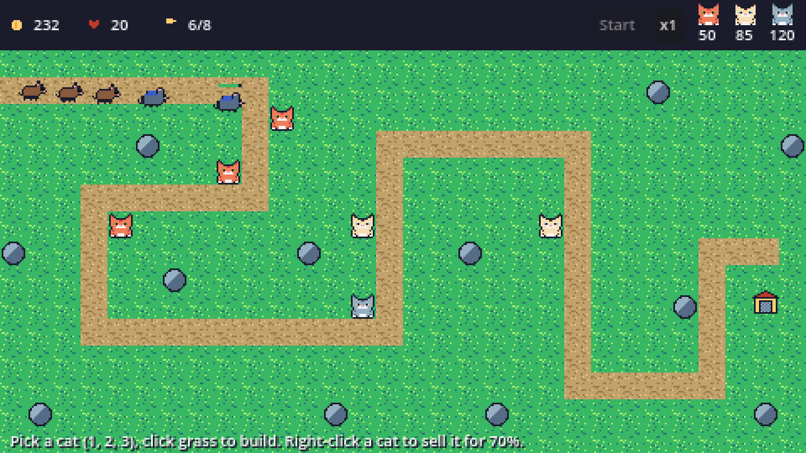

# Depot Gato

A 2D pixel-art tower defense game in Godot 4 and GDScript. Waves of mice and rats walk a winding dirt road toward the depot; you place cats on the grass to stop them.



## Play

1. Install [Godot 4](https://godotengine.org/) (made with 4.7).
2. Open `project.godot` and press F5.

| Input | Action |
| --- | --- |
| Click a cat in the top bar, or press 1, 2, 3 | Choose a tower |
| Left-click grass | Build it (hold Shift to keep building) |
| Right-click a cat | Sell it for 70% |
| Right-click or Esc | Cancel the selection |
| Space or Start | Start the next wave now |
| x1 / x2 | Game speed |

| Cat | Cost | Range | Role |
| --- | --- | --- | --- |
| Tabby | 50 | short | Fast kibble shots, cheap single-target damage |
| Siamese sniper | 85 | long | Slow, heavy fish shots |
| Yarn bomber | 120 | medium | Yarn balls that hit everything in the blast |

| Enemy | HP | Speed | Lives lost if it gets through |
| --- | --- | --- | --- |
| Mouse | 14 | fast | 1 |
| Rat | 45 | medium | 2 |
| Armored rat | 160 | slow | 5 |

Eight waves; health scales up wave by wave. You start with 120 coins and 20 lives. Kills and cleared waves pay coins.

## How it is built

- **Scenes:** `main.tscn` holds the level, towers, enemies, projectiles, placement, the wave manager and the HUD as separate nodes. Each enemy, tower and projectile is its own scene, instanced at runtime.
- **Map and navigation:** `level.gd` turns an ASCII map into a `TileMapLayer`. Path tiles carry a navigation polygon, so the tile layer itself is the navigation mesh. Each enemy steers with a `NavigationAgent2D`.
- **Enemy state machine:** `IDLE` (waiting for the navigation map to sync), `WALKING`, `ATTACKING` (reached the depot) and `DEAD`. Walk, hurt and death animations run on an `AnimationPlayer`.
- **Towers:** one `tower.gd` with exported stats. An `Area2D` keeps the live list of enemies in range; a `Timer` drives the cooldown; shots leave from a `Marker2D`. The target is the enemy with the shortest remaining path to the depot, skipping anything freed or dying.
- **Splash damage:** the yarn ball carries its own blast `Area2D` and damages every enemy inside it on impact.
- **Waves as data:** each wave is a `WaveData` resource in `data/waves/`: enemy scene, count, spawn interval and health scale. Rebalancing is a data edit.
- **Signals, not references:** `GameState` (autoload) owns coins, lives and the wave number and emits signals; the HUD only listens.
- **Pixel art in code:** every sprite is a few lines of text in `scripts/art.gd`, one character per pixel, turned into textures at startup. Nearest filtering and pixel snapping keep it crisp.
- **Physics layers:** enemies on layer 1, tower ranges on 2, projectiles on 3. Tower ranges and projectiles only scan for enemies.

## Tests

```sh
godot --headless --fixed-fps 60 res://tests/run_tests.tscn
```

28 checks, including three complete games played by the test itself, as fast as the CPU allows:

- **No towers:** enemies leave the spawn, follow the path tiles and the depot falls.
- **A full build plan:** all eight waves are held.
- **Three Tabbies only:** the defence falls mid-game, so the waves really do escalate.

It also checks the sprites, the economy, the map connection, the wave data, the placement rules and the 70% sell refund.

## Screenshots

`tools/capture.tscn` plays a scripted game and saves the images in `docs/`:

```sh
godot --path . res://tools/capture.tscn -- docs
```

## Licence

MIT
